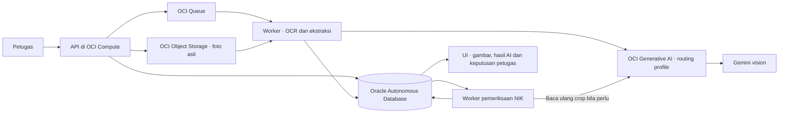

# Ruang Dokumen KK

Kalau ada 12 foto KK yang di-upload sekaligus, kita ingin bisa buka hasil tiap KK dan langsung lihat siapa saja anggotanya. Nama, NIK dan tanggal lahir harus masuk ke orang yang tepat. Kalau satu digit NIK kurang jelas, petugas bisa buka potongan gambar untuk anggota itu, cek cetakannya, lalu simpan keputusan. Hasil awal AI tetap bisa dilihat.

**[Coba demo dengan dua KK fiktif](https://orajsn.github.io/oci-kk-document-workbench/Simulasi-Review-NIK.html)**. Pada **Contoh 02**, pilih **Buka hasil**, lalu **Periksa NIK anggota ini**. Perbesar angkanya. Pilih **Lihat seluruh baris anggota** untuk mengecek nama dan NIK dalam satu baris. Keputusan latihan tersimpan di browser. Versi offline ada di [demo/field-review.html](demo/field-review.html) setelah repo diunduh.

## Coba bulk upload di laptop

Pakai Python 3.11 atau lebih baru. Dari folder repo, jalankan

```sh
python run_local.py --port 8876 --data-dir runtime/day-one --reference-dir demo/day-one/reader
```

Buka [aplikasi lokal](http://127.0.0.1:8876), pilih **Unggah KK**, isi **Nomor referensi**, lalu pilih **Rekaman latihan**. Upload kedua PNG dari `demo/day-one/` sekaligus. Buka satu KK dan pilih tab **Anggota**. [Panduan dari upload sampai tuning](docs/DAY-ONE.md) menunjukkan digit yang perlu dikoreksi, cara membuka hasil setelah restart, dan cara mencoba ambang baca ulang pada batch yang sama.

## Alur di OCI Batam



Foto masuk lewat aplikasi di Batam. Worker mengambil job dari OCI Queue, membaca gambar, lalu menyimpan data keluarga dan anggotanya di Oracle Database. Setelah hasil tersimpan, router memeriksa NIK per anggota. Petugas bisa membuka crop untuk kasus yang masih meragukan.

Di konfigurasi contoh, aplikasi dan penyimpanan ada di Batam. Panggilan Gemini memakai routing profile on-demand dengan tujuan Chicago dan diproses di Google Americas. Saat memasang di tenancy sendiri, tim OCI perlu memeriksa profile dan memastikan tujuan pemrosesan sudah disetujui. API hanya mendengarkan di loopback dan diakses lewat tunnel privat. Pilot memakai identitas operator dari konfigurasi SSH. Untuk beberapa petugas di produksi, siapkan login per pengguna.

## Kalau ada field yang salah, apa yang bisa dituning?

| Yang terlihat di hasil | Mulai cek di sini |
|---|---|
| NIK terbaca jelas, tapi masuk ke anggota lain | Buka seluruh baris. Cek orientasi gambar, posisi crop, dan nama yang dipasangkan ke baris itu. |
| Anggotanya sudah benar, tapi nol di depan hilang atau nilai masuk ke field lain | Bandingkan cetakan dengan respons model, lalu cek prompt, schema JSON dan parser. |
| Terlalu banyak NIK ke petugas, atau ada NIK salah yang lolos | Uji ambang OCR dan aturan baca ulang. Hitung kedua kasus tadi, berikut waktu dan jumlah panggilan per KK. |

Tuning di repo ini mengubah cara aplikasi menyiapkan gambar, meminta hasil dari Gemini dan memeriksanya. Aplikasi memakai bobot model Gemini yang disediakan layanan. [File dan contoh eksperimen per tahap](docs/TUNING.md)

## Untuk tim yang menerima repo

| Keperluan | Panduan atau folder |
|---|---|
| Pasang di OCI, pantau worker, atau rollback | [Operasi](docs/OPERATIONS.md) · `deploy/` · [Terraform](infra/README.md) |
| Cek hasil dan riwayat review langsung di Oracle | [Uji serah terima](docs/HANDOVER.md) · `sql/` |
| Telusuri alur dari upload sampai hasil tersimpan | `web/` dan `kkpilot/` |
| Telusuri alasan NIK dibaca ulang | `nik_router/` |
| Cari contoh, tes, atau perubahan antarversi | `demo/` · `examples/` · `tests/` · [Changelog](CHANGELOG.md) |

Isi resource tenancy dan profil crop di konfigurasi privat. Gambar asli, respons OCR, wallet dan Terraform state disimpan di lingkungan tim penerima.

Untuk tes backend, jalankan `python -m unittest discover -s tests -p "test_backend_*.py"`. Untuk seluruh suite, pasang dependensi dari `requirements-test.txt` di virtual environment, lalu jalankan `python -m unittest discover -s tests`.
