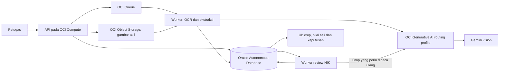

# KK Document Workbench for OCI

Ekstraksi Kartu Keluarga dari gambar menjadi record rumah tangga dan baris anggota. Aplikasi menyediakan bulk upload, penyimpanan sumber, antrean ekstraksi dan pemeriksaan NIK per anggota. Ketika satu angka sulit dibaca, petugas dapat membuka crop, membandingkannya dengan nilai AI, lalu mencatat keputusan secara terpisah.

## Mulai dari nol

Ikuti [latihan bulk upload, review, dan tuning satu NIK](docs/DAY-ONE.md). Anda membutuhkan Python 3.11+ dan browser. Dua gambar fiktif sudah tersedia. Setelah satu digit dikoreksi dan server direstart, Anda dapat membuka kembali nilai awal dan keputusan petugas, lalu membandingkan tiga ambang baca ulang pada batch yang sama. Latihan dapat dijalankan dari clone Git atau folder `portable-edition` di paket serah terima privat.

Untuk pemeriksaan backend, jalankan `python -m unittest discover -s tests -p "test_backend_*.py"`. Untuk suite lengkap, instal `requirements-test.txt` pada virtual environment dan jalankan `python -m unittest discover -s tests`. Pengujian preprocessing yang memerlukan OpenCV bersifat opsional.

## Arsitektur deployment OCI

Entry point contoh memakai OCI Batam. Rute on-demand contoh menargetkan Chicago dengan pemrosesan Gemini di Google Americas. Pemilik deployment memasok, memverifikasi dan menyetujui profile sendiri. API cloud bind ke loopback dan dirancang untuk diakses melalui tunnel privat. Identitas operator di pilot mengikuti identitas SSH terkonfigurasi; akses multi-petugas produksi membutuhkan autentikasi per pengguna.

## Titik tuning

| Saat ada masalah | Yang diubah | Yang dibuktikan |
|---|---|---|
| Angka dari anggota lain ikut terbaca | Orientasi, batas crop dan pengikatan nama ke baris | Crop lengkap untuk orang yang benar |
| Nilai di gambar terlihat tetapi hasil berubah format atau field | Prompt, kontrak JSON dan parser | Karakter sumber, leading zero, null dan urutan anggota tetap terjaga |
| Terlalu banyak atau terlalu sedikit review | Ambang bukti OCR, konflik struktur, baca ulang dan aturan nomor lama | NIK salah lolos, NIK benar ikut review, waktu dan panggilan per dokumen |

Panduan [tuning dan evaluasi](docs/TUNING.md) menjelaskan file serta fungsi yang mengendalikan tiap tahap. Model Gemini dipanggil lewat layanan terkelola. Perubahan di sini memengaruhi input, instruksi, validasi dan routing. Bobot model tidak dilatih oleh aplikasi.

## Untuk tim penerima

- [Runbook instalasi, layanan dan rollback](docs/OPERATIONS.md)
- [Checklist serah terima dan uji penerimaan](docs/HANDOVER.md)
- [Riwayat perubahan](CHANGELOG.md)

| Direktori | Isi |
|---|---|
| `kkpilot/`, `web/` | API, UI, worker, kontrak model, pipeline OCR dan penyimpanan |
| `nik_router/` | Pemeriksa post-commit, pembacaan crop, ledger dan kebijakan format lama |
| `sql/` | Skema Oracle, grant runtime dan event keputusan review |
| `deploy/`, `infra/` | Unit systemd, contoh environment dan Terraform yang dinonaktifkan secara default |
| `tests/`, `examples/`, `demo/` | Pemeriksaan lokal dan contoh sintetis |

Repo publik memakai konfigurasi kosong untuk resource tenancy dan profil crop. Buat konfigurasi privat milik penerima sebelum live. Foto keluarga asli, OCR response, evaluator berisi data pribadi, wallet, state Terraform dan deck customer disimpan di luar repo.
