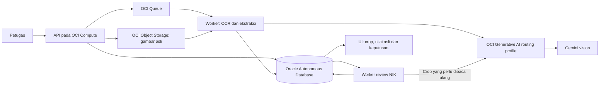

# Ruang Dokumen KK

Unggah foto kartu keluarga, buka hasil per anggota, lalu cocokkan angka yang meragukan dengan cetakannya. Petugas dapat menyimpan koreksi dan membuka kembali nilai awal.

## Coba di laptop

**Lihat pemeriksaan NIK.** Buka [contoh interaktif](demo/field-review.html) dari folder hasil unduhan di browser. Dua berkas fiktif sudah tersedia. Pilih **Buka hasil → Periksa NIK anggota ini** untuk membandingkan gambar dan hasil pembacaan. Keputusan latihan disimpan di browser tersebut.

**Coba bulk upload.** Dengan Python 3.11 atau lebih baru, jalankan perintah berikut dari folder repo:

```sh
python run_local.py --port 8876 --data-dir runtime/day-one --reference-dir demo/day-one/reader
```

Buka [Ruang Dokumen lokal](http://127.0.0.1:8876). Pilih **Unggah KK**, isi **Nomor referensi**, pilih **Rekaman latihan**, lalu unggah kedua PNG dari `demo/day-one/`. Buka satu hasil dan pilih tab **Anggota**. Untuk mencoba koreksi, restart dan tuning pada batch yang sama, ikuti [latihan penerima](docs/DAY-ONE.md).

## Untuk engineer

- [Instalasi OCI dan rollback](docs/OPERATIONS.md)
- [Uji penerimaan di Oracle Database](docs/HANDOVER.md)
- [Tuning OCR, prompt dan pemicu baca ulang NIK](docs/TUNING.md)
- [Riwayat rilis](CHANGELOG.md)

## Arsitektur deployment OCI



Pada konfigurasi contoh, aplikasi menerima unggahan di OCI Batam. Rute on-demand contoh menargetkan Chicago dengan pemrosesan Gemini di Google Americas. Pemilik deployment memasok, memverifikasi dan menyetujui profile sendiri. API cloud bind ke loopback dan dirancang untuk diakses melalui tunnel privat. Identitas operator di pilot mengikuti identitas SSH terkonfigurasi; akses multi-petugas produksi membutuhkan autentikasi per pengguna.

## Titik tuning

| Saat ada masalah | Yang diubah | Yang dibuktikan |
|---|---|---|
| Angka dari anggota lain ikut terbaca | Orientasi, batas crop dan pengikatan nama ke baris | Crop lengkap untuk orang yang benar |
| Nilai di gambar terlihat tetapi hasil berubah format atau field | Prompt, kontrak JSON dan parser | Karakter sumber, leading zero, null dan urutan anggota tetap terjaga |
| Terlalu banyak atau terlalu sedikit review | Ambang bukti OCR, konflik struktur, baca ulang dan aturan nomor lama | NIK salah lolos, NIK benar ikut review, waktu dan panggilan per dokumen |

Panduan [tuning dan evaluasi](docs/TUNING.md) menjelaskan file serta fungsi yang mengendalikan tiap tahap. Model Gemini dipanggil lewat layanan terkelola. Perubahan di sini memengaruhi input, instruksi, validasi dan routing. Bobot model tidak dilatih oleh aplikasi.

| Direktori | Isi |
|---|---|
| `kkpilot/`, `web/` | API, UI, worker, kontrak model, pipeline OCR dan penyimpanan |
| `nik_router/` | Pemeriksa post-commit, pembacaan crop, ledger dan kebijakan format lama |
| `sql/` | Skema Oracle, grant runtime dan event keputusan review |
| `deploy/`, `infra/` | Unit systemd, contoh environment dan Terraform yang dinonaktifkan secara default |
| `tests/`, `examples/`, `demo/` | Pemeriksaan lokal dan contoh sintetis |

Untuk deployment, masukkan resource tenancy dan profil crop ke konfigurasi privat. Simpan gambar asli, respons OCR, wallet dan state Terraform di lingkungan penerima.

## Menjalankan tes

Tes backend dapat dijalankan dengan `python -m unittest discover -s tests -p "test_backend_*.py"`. Untuk suite lengkap, pasang `requirements-test.txt` di virtual environment lalu jalankan `python -m unittest discover -s tests`.
