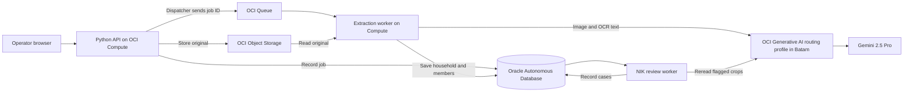

# KK Document Workbench

A *Kartu Keluarga* (KK) is an Indonesian family card. One image can contain an entire household. KK Document Workbench turns a batch of these images into household records and member rows, keeping each person's name, birth date and national identification number (NIK) together.

When the application cannot verify a NIK, the reviewer can open the relevant row, compare the printed digits with the original reading, and confirm, correct or mark the number unreadable. The original extraction remains available after a correction.

**[Try the two-card browser demo](https://orajsn.github.io/oci-kk-document-workbench/field-review.html)** or **[download the release](https://github.com/orajsn/oci-kk-document-workbench/releases/tag/v0.4.3)**.

## Choose a way to try it

| Experience | What you can do | Where the data goes |
| --- | --- | --- |
| Browser demo | Open one of two fictional cards, inspect a cropped NIK, save a decision and reopen it. No installation or account is required. | The decision stays in that browser. |
| Local batch exercise | Upload two supplied PNGs in one batch, correct one member's NIK, restart the app and compare reread thresholds. | Python uses prerecorded readings and a local SQLite database. |
| OCI deployment | Process approved images using OCR and OCI Generative AI, save the extraction in Oracle Database and route uncertain NIKs for review. | In the Batam pilot, originals and records are stored in Batam. Model inference runs outside Indonesia. |

The public repository contains the portable application and fictional examples. The hosted pilot also has a separately managed HTTPS gateway and participant login. The implementation here includes the private operator interface accessed over an SSH tunnel.

## Run your first batch

Use Python 3.11 or later. Run this command from the repository root.

```sh
python run_local.py --port 8876 --data-dir runtime/day-one --reference-dir demo/day-one/reader
```

Open [the local workspace](http://127.0.0.1:8876), choose **Upload cards**, enter a batch reference and select **Recorded sample**. Pick `kartu-a.png` and `kartu-b.png` from `demo/day-one/` together. Each file gets its own job ID.

In card B, the last digit of the second member's NIK differs from the print. The [first-batch walkthrough](docs/DAY-ONE.md) shows how to correct it and prove that both readings survive a restart.

<a id="alur-di-oci-batam"></a>

## How a card reaches Oracle Database



The VM calls OCI services through the Python SDK using an IAM instance principal. The application connects to the private database endpoint with `python-oracledb` and a wallet for mutual TLS. Where configured, OCI Document Understanding supplies an additional NIK reading. A reviewer can inspect the image and the original result before recording a decision.

## Find the right guide

| If you need to… | Start here |
| --- | --- |
| Check a complete batch and reopen a correction | [First batch](docs/DAY-ONE.md) |
| Install the private OCI services, monitor jobs or roll back | [Operations](docs/OPERATIONS.md) and [infrastructure template](infra/README.md) |
| Verify the model result and review history in Oracle | [Engineering handover](docs/HANDOVER.md) |
| Diagnose a wrong digit or a value assigned to the wrong member | [Field tuning](docs/TUNING.md) and [crop geometry](docs/GEOMETRY.md) |
| See what changed in a release | [Changelog](CHANGELOG.md) |

The web UI is in `web/`, the application and extraction adapters are in `kkpilot/`, and the post-save NIK checks are in `nik_router/`. Database schemas and acceptance queries are in `sql/`.

To run the backend tests, use `python -m unittest discover -s tests -p "test_backend_*.py"`. For the full suite, install `requirements-test.txt` in a virtual environment, then run `python -m unittest discover -s tests`. Keep tenancy settings, wallets, real images, OCR diagnostics and Terraform state in your own environment.
